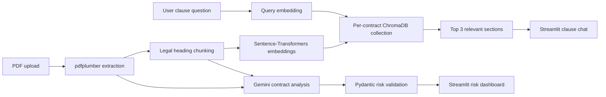

# Legal Contract Analysis & Risk Assessment

[](https://www.python.org/)
[](https://streamlit.io/)
[](https://ai.google.dev/)
[](https://www.trychroma.com/)

An AI-assisted contract review application for exploring contract terms, retrieving relevant clauses, and highlighting potential legal and commercial risks. It combines document extraction, semantic retrieval, and LLM-based analysis in a Streamlit interface.

> **Important:** This tool provides informational analysis, not legal advice. Have qualified counsel review important decisions and contract language.

## Project Overview & Architecture

The application uses a retrieval-augmented workflow for PDF clause search. Uploaded PDFs are extracted with `pdfplumber`, split into text sections, embedded locally, and stored in a persistent ChromaDB collection. A user question is embedded with the same model and matched against that contract's stored sections. Separately, Gemini analyzes the contract and produces structured clause-level risk findings validated with Pydantic.



The main upload flow also supports DOCX and TXT extraction and the existing contract summary, entity, obligation, unfavorable-clause, and report features. Semantic clause retrieval in ChromaDB is currently exposed for PDF uploads.

## Key Features & Enhancements

- **Robust PDF text extraction:** Uses `pdfplumber` to extract text page by page and skips pages with no extracted text. DOCX and TXT files continue to use their format-specific extractors.
- **Legal-section chunking:** Splits text at recognized headings for **Indemnity, Termination, Governing Law, Confidentiality, and Payment**, retaining each heading with its section text. Other text is kept in chunks too. *Liability is not currently a dedicated heading boundary; liability language can still be found semantically within indexed text.*
- **Persistent semantic clause search:** Stores PDF sections and their heading/source metadata in ChromaDB using `all-MiniLM-L6-v2` embeddings. The chat interface retrieves up to three relevant sections for a question. The local database is written under `./chroma_db` relative to the app's working directory.
- **Structured risk findings:** The Gemini analyzer requests JSON output and validates clause findings against the shared Pydantic `RiskAssessment` model. Accepted risk levels are exactly `High`, `Medium`, and `Low`; malformed or out-of-schema responses raise an error rather than being presented as validated findings.
- **Review dashboard:** Shows risk-level counts and clause cards with the identified issue and recommended action, alongside the existing full-contract risk and analysis views.
- **Contract utilities:** Retains contract classification, entity and obligation analysis, plain-language summaries, unfavorable-clause alternatives, template browsing, and PDF report generation.

### Performance and operational notes

The embedding model is cached after its first load, but initial model loading may take time and require downloading model files. Search latency depends on hardware, database size, and whether the model is already loaded; no sub-second performance target has been benchmarked or guaranteed.

The persistent vector store is useful for local reuse and per-contract retrieval, but it is not configured as a multi-user hosted database or automatic data-retention system. Manage `chroma_db` according to your privacy and retention requirements.

## Tech Stack

| Area | Technologies |
| --- | --- |
| User interface | Python, Streamlit |
| PDF / document extraction | pdfplumber, python-docx |
| Vector storage and retrieval | ChromaDB |
| Embeddings | Sentence-Transformers, `all-MiniLM-L6-v2` |
| LLM analysis | Google Gemini API (`gemini-2.5-flash`) |
| Structured validation | Pydantic |
| Configuration | python-dotenv |
| Reports and supporting features | ReportLab, pandas, Plotly |

The active Streamlit app uses Gemini. An Anthropic-backed analyzer is also present in `src/utils/analyzer.py`; it is not the app's configured analyzer.

## Folder Structure

```text
.
├── app.py
├── requirements.txt
├── .gitignore
├── sample_contracts/
└── src/
    └── utils/
        ├── __init__.py
        ├── analyzer.py             # Anthropic analyzer and shared RiskAssessment model
        ├── document_processor.py   # PDF, DOCX, and TXT extraction; legal chunking
        ├── gemini_analyzer.py      # Active Gemini analysis and Pydantic validation
        ├── report_generator.py     # PDF report generation
        ├── templates.py            # Contract template content
        └── vector_store.py         # Persistent ChromaDB and semantic search
```

At runtime, the vector database is created in `chroma_db/` under the current working directory. It is generated data and is not part of the source layout.

## Local Setup & Installation

### 1. Clone the repository

```bash
git clone https://github.com/Srihithavss-coding/Agent-Contract-Analyzer.git
cd Agent-Contract-Analyzer
```

### 2. Create and activate a virtual environment

**Windows PowerShell**

```powershell
python -m venv venv
.\venv\Scripts\Activate.ps1
```

**macOS / Linux**

```bash
python3 -m venv venv
source venv/bin/activate
```

Python 3.10 or newer is recommended.

### 3. Install dependencies

```bash
python -m pip install --upgrade pip
pip install -r requirements.txt
```

The first embedding-model use may download `all-MiniLM-L6-v2` from Hugging Face.

### 4. Configure the Gemini API key

Create a `.env` file in the project root:

```dotenv
GEMINI_API_KEY=your_google_gemini_api_key
```

The app also accepts `GOOGLE_API_KEY`. Obtain a key from [Google AI Studio](https://aistudio.google.com/app/apikey). Keep the real value private; do not paste it into source code or commit it.

### 5. Run the application

```bash
streamlit run app.py
```

Open the local URL printed by Streamlit, upload a contract, extract its text, and run the analysis. For a PDF, extracted sections are indexed for clause questions in the upload view.

## Security & Best Practices

- **Environment Isolation:** Keep API credentials secure in a local `.env` file. `.gitignore` explicitly excludes `.env` and sensitive local files while tracking `.env.example`.
- **Credential Protection:** Never hardcode API keys or sensitive tokens in source code, notebooks, or logs. 
- **Data Privacy:** Contracts and extracted clauses are processed locally via ChromaDB and your private Gemini API endpoint. Review Google AI Studio's data privacy terms when handling sensitive legal documents.