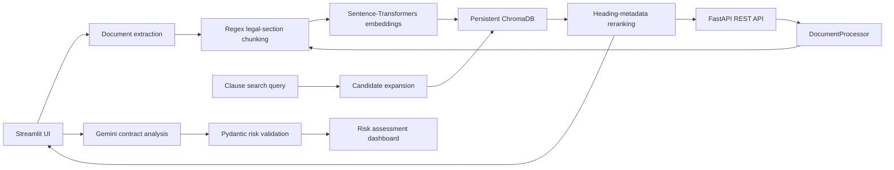

# Production-Grade Gen AI Contract Analyzer

[](https://www.python.org/)
[](https://fastapi.tiangolo.com/)
[](https://streamlit.io/)
[](https://ai.google.dev/)
[](https://www.trychroma.com/)

An AI-assisted contract review application for retrieving relevant clauses, analyzing contract terms, and surfacing legal and commercial risks. It combines a Streamlit user interface, a FastAPI retrieval API, locally generated semantic embeddings, persistent ChromaDB storage, and Gemini-based analysis.

> **Important:** This tool provides informational analysis, not legal advice. Have qualified counsel review important decisions and contract language.

## Enterprise Architecture

The application has two entry points: Streamlit for interactive contract review and FastAPI for programmatic clause indexing and retrieval. Both use the shared document-processing and vector-store utilities. Uploaded PDF, DOCX, and TXT documents are extracted and split at recognized legal section headings. PDF sections are embedded locally and stored in a persistent ChromaDB collection. Gemini produces contract analysis and structured risk findings, with Pydantic validation applied to clause-level assessments.



### Advanced RAG Engineering

- **Legal-aware regex chunking:** A custom, case-insensitive heading pattern recognizes numbered/article/section-style, standalone, separator-delimited, and uppercase section boundaries for **Duties, Compensation, Term, Termination, Liability, Safety, and Indemnification**. It also recognizes Indemnity, Limitation of Liability, Governing Law, Confidentiality, and Payment. A recognized heading stays with its section body; unmatched text is retained rather than discarded.
- **Hybrid Metadata Boosting Retriever:** Each chunk is stored with `heading` and `source` metadata. For a query, ChromaDB first retrieves an expanded candidate pool of up to `top_k × 3` sections by semantic distance. The retriever then matches query terms to legal-heading metadata and ranks matching headings ahead of general semantic matches within that candidate pool, using vector distance to order candidates within each group. This prevents general text from outranking a matching, specifically headed clause in the candidate set, reducing semantic bleeding—for example, when a query targets Termination or Liability.
- **Per-contract retrieval:** The Streamlit flow creates a separate persistent collection for each PDF. The API provides `POST /contracts/index` and `POST /clauses/search`; API-created collections are keyed to the indexed contract and reused for subsequent searches.
- **Local embeddings and persistence:** `Sentence-Transformers` runs `all-MiniLM-L6-v2` locally. ChromaDB persists vectors and metadata under `./chroma_db`; model files may be downloaded the first time the embedding model loads.

## Key Features

- **Risk assessment dashboard:** Displays risk-level metrics and clause-level findings with identified issues and recommended actions, alongside contract summaries, entities, obligations, unfavorable clauses, and report generation.
- **Secure API key handling:** The Streamlit app reads `GEMINI_API_KEY` or `GOOGLE_API_KEY` from the environment or Streamlit secrets. Alternatively, users can enter a key in a password-masked field for the current session. Keys are not stored in contract data or included in API responses. Keep credentials out of source control.
- **Fallback behavior:** If a Gemini error interrupts the multi-step contract analysis, the current analyzer returns a clearly described structural preview with empty or fallback analysis fields. It is not a substitute for a successful analysis. Clause-level structured findings are Pydantic-validated; an invalid response raises an error and is surfaced by the app instead of being treated as validated output. Retrieval and indexing do not require a Gemini API key.
- **Document support:** Extracts PDF, DOCX, and TXT documents. Semantic clause search is available for the indexed contract sections.
- **API health and interactive docs:** FastAPI exposes `GET /health` and publishes its OpenAPI interface at `/docs` while the service is running.

## Technology Stack

| Area | Technologies |
| --- | --- |
| User interface | Streamlit |
| REST API | FastAPI, Pydantic |
| Document extraction | pdfplumber, python-docx |
| Legal-section chunking | Custom Python regular expressions |
| Embeddings | Sentence-Transformers, `all-MiniLM-L6-v2` |
| Vector storage and retrieval | ChromaDB |
| Generative analysis | `google.generativeai` (Gemini) |
| Configuration | python-dotenv, environment variables, Streamlit secrets |
| Reports and supporting features | ReportLab, pandas, Plotly |

## Local Setup & Installation

### 1. Clone the repository

```bash
git clone https://github.com/Srihithavss-coding/Agent-Contract-Analyzer.git
cd Agent-Contract-Analyzer
```

### 2. Create and activate a virtual environment

**Windows PowerShell**

```powershell
python -m venv .venv
.\.venv\Scripts\Activate.ps1
```

**macOS / Linux**

```bash
python3 -m venv .venv
source .venv/bin/activate
```

Python 3.10 or newer is recommended.

### 3. Install dependencies

```bash
python -m pip install --upgrade pip
pip install -r requirements.txt
```

The first embedding-model use may download `all-MiniLM-L6-v2` from Hugging Face.

### 4. Configure Gemini (for AI contract analysis)

Create a `.env` file in the project root:

```dotenv
GEMINI_API_KEY=your_google_gemini_api_key
```

The app also accepts `GOOGLE_API_KEY`. Obtain a key from [Google AI Studio](https://aistudio.google.com/app/apikey). Keep the real value private; do not paste it into source code or commit it. The FastAPI clause-indexing and search endpoints do not require a Gemini key.

### 5. Run the Streamlit application

```bash
streamlit run app.py
```

Open the local URL printed by Streamlit, upload a contract, extract its text, and run the analysis. For PDF uploads, extracted sections are indexed for clause search.

### 6. (Optional) Run the FastAPI service

In a second terminal with the virtual environment activated:

```bash
uvicorn src.api:app --reload
```

The service listens on `http://127.0.0.1:8000` by default. Visit `http://127.0.0.1:8000/docs` for the interactive API documentation.

## 📸 Application Previews

### 1. Document Extraction 
The application parses complex PDF contracts, cleanly breaking them down by legal boundaries (Duties, Compensation, Termination, Liability, Safety) and indexing them with metadata.


### 2. Risk Assessment Dashboard
An interactive Streamlit dashboard powered by Pydantic-validated risk cards that automatically flag commercial risks, liabilities, and missing clauses.


**Index a contract**

```http
POST /contracts/index
Content-Type: application/json

{
  "source": "sample-contract.pdf",
  "text": "Paste the extracted contract text here..."
}
```

The response contains a `contract_id` and the number of indexed sections. Use that ID to search:

```http
POST /clauses/search
Content-Type: application/json

{
  "contract_id": "contract_<32-character-hex-id>",
  "question": "What does the termination clause say?",
  "top_k": 3
}
```

## Operational and Privacy Notes

- The FastAPI development server binds to localhost by default. Do not expose it to an untrusted network without adding authentication, authorization, rate limiting, and TLS at an appropriate deployment boundary.
- ChromaDB stores generated local data in `./chroma_db`. It is not configured as a multi-user hosted database or automatic data-retention system; manage this directory according to your privacy and retention requirements.
- Contract text is processed locally for extraction, embeddings, and retrieval. Gemini analysis sends contract content to Google's API; review the applicable data privacy terms before processing sensitive documents.
- Risk findings are informational, can be incomplete, and should be reviewed by qualified counsel.
